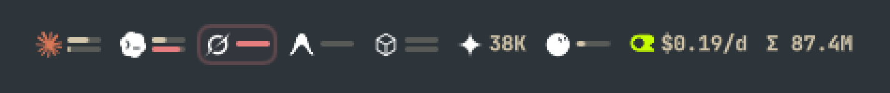

# Omarchy Agent Stats

Your AI coding subscriptions' rate limits and today's token count, right in the
Omarchy bar.



Each subscription gets a two-letter badge (`CL` Claude, `CX` Codex, `GK` Grok,
…) with two thin meters: the short session window (5-hour) on top and the
weekly window below. A meter turns the bar's urgent color at 80% by default.
An agent whose limits couldn't be refreshed is shown faded. After the meters,
`Σ 35.9M` is the total tokens used today across every agent.

**Bar layout** (right-click menu, or Display & alerts) controls how much space
the strip uses:

| Layout | Bar shows |
|---|---|
| **Full** (default) | Badges, meters, prepaid / extra text |
| **Compact** | Badges only for every shown provider |
| **Alerts** | Badges only for providers near a limit (or low balance); `OK` when none are |
| **Summary** | One chip (`OK`, or `2|8%` for count and tightest remaining) |

**Sort** orders the bar and the Usage panel: **Name**, **Critical** (least
remaining first), or **Calm** (healthiest first). Near-limit uses the same
threshold as the low-usage ring (`lowAlertAt` / low balance). **Today total (Σ)**
can be hidden from the bar. The **Usage…** panel lists every shown provider with
meters; click a row to launch that agent. In Compact / Alerts / Summary, clicking
`Σ` or the summary / `OK` chip opens Usage instead of the Agents panel.

| Action | On an agent | On the token total / summary |
|---|---|---|
| Hover | Each limit's % and time to reset | Today's tokens per agent / alert summary |
| Left click | Open that agent in a terminal | Full: Agents panel · else: Usage list |
| Right click | Open the menu | Open the menu |
| Middle click | Refresh usage now | Refresh usage now |

An agent opens through Omarchy's own `omarchy-agent` launcher, in the same
terminal with the same flags and account as the `Super` launch; your default
agent setting is never changed. Providers with no app of their own open their
usage page instead (DeepSeek's usage page, AI Studio usage for Gemini, the Cursor
dashboard for Grok Bot, OpenRouter activity), and an agent whose CLI isn't
installed opens its page or else the Agents panel. While Cursor's sign-in is in
`~/.config/cursor/auth.json` (the workaround for omacom/omarchy#19559), Cursor
starts with the display hidden from it, so launching it from the bar doesn't
move the sign-in back into the keyring and blank its usage and Grok Bot's.

The right-click menu holds the everyday choices: **Bar layout**, **Sort**,
**Today total (Σ)**, **Agent badge** (letters or logos), **Update frequency**,
**Show in bar** (each provider on or off), then **Usage…**, **Settings &
providers…**, **Agents panel** and **Refresh**.

**Settings & providers…** opens a setup screen in Omarchy's floating terminal.
Its **Display & alerts** page covers the rest: bar layout and sort, the activity
pulse, when meters turn red, the low usage ring and its threshold (also used by
Alerts / Summary), what prepaid providers show and their low-balance ring, where
OpenRouter's numbers come from, and the Claude extra-usage check. Below it are
the providers themselves (see "Providers and keys").

Choices are saved to the widget's entry in `~/.config/omarchy/shell.json` through
`omarchy bar set`. You can also toggle the menu from a keybinding or script:

```bash
omarchy-shell io.github.andrewknown.agent-stats toggle
```

## How it works

The widget does no collection of its own. It reads the usage records that
Omarchy's built-in **Agents** plugin (`omarchy.agents`) keeps in
`~/.local/state/omarchy/agents/usage/`, through a small bundled Python script
(`read.py`). By default it makes no network requests and only reads local
files (plus `/proc` when the activity pulse is on).

The optional network checks (live OpenRouter, Claude extra usage, Gemini API)
live in `remote.py`. Each runs in the background on its own timer and leaves its
result, or its error, in a cache file under `~/.local/state/omarchy-agent-stats/`;
`read.py` only ever reads those, so a slow or stuck check never holds up the
bar. A result older than three checks shows as stale. The Claude check never
runs more often than every 5 minutes, since it shares Anthropic's rate limit
with Omarchy's own Claude checks, and waits as long as Anthropic asks after a
"too many requests" answer.

## Providers and keys

The widget shows every provider Omarchy's Agents plugin tracks that has limits
or a balance (Antigravity, Claude, Codex, Copilot, Cursor, DeepSeek, Grok, Grok
Bot, Kimi, Ollama Cloud, OpenRouter, Z.ai and more, as you sign in to them),
plus the Gemini API, in alphabetical order.

**Settings & providers…** in the menu opens a small setup screen in Omarchy's
floating terminal (`providers.py`). It lists every provider with what Omarchy
currently reports, and for each one:

- **OpenRouter, Z.ai, Ollama Cloud**: set, replace or remove the API key (and
  OpenRouter's management key), typed hidden and saved owner-only in Omarchy's
  own `~/.config/omarchy/agents/<provider>.json`, so Omarchy uses it too. An
  environment variable such as `OPENROUTER_API_KEY` still takes precedence and
  is shown as such.
- **Claude, Codex, Grok**: sign in or add an account through Omarchy's own
  `omarchy agent account add`, or list accounts.
- **Cursor and Grok Bot**: shows where the Cursor sign-in is stored and, while
  it's in the keyring Omarchy can't read yet, signs in again so it's saved to
  the file Omarchy reads.
- **Everyone else**: Omarchy reads the provider's own app or CLI sign-in; the
  screen shows Omarchy's hint for it.
- **Test** re-collects that provider with Omarchy's updater and shows the result.

Keys are never shown in full or written anywhere else.

**Show in bar** in the menu toggles each provider on or off in the bar
(`hiddenAgents`, a comma-separated list of ids such as `grok,kimi`).

## Google Gemini API (AI Studio)

Pick **Gemini API (AI Studio)** in **Settings & providers…** to show Gemini API
usage in the bar (its logo, or `GM` with letter badges): today's tokens, with requests (and failures) and
input/output tokens per model on hover. Click it to open AI Studio's usage page.

- It needs the Google Cloud CLI (`gcloud`), signed in to the Google account your
  AI Studio keys belong to; the Providers screen can run `gcloud auth login`.
- **Choose projects** lists your Google Cloud projects that had Gemini API
  requests in the last 7 days; pick the ones to show (`geminiProjects`).
- Numbers come from Google Cloud Monitoring (`serviceruntime` request counts and
  the `generativelanguage.googleapis.com` token metrics), asked every 5 minutes
  or at the Update frequency, with a short-lived token from
  `gcloud auth print-access-token`, sent only to monitoring.googleapis.com and
  never stored. "Today" is since local midnight.
- **No spend or balance.** Google offers no API for Gemini API spend or prepay
  credit; they're only in AI Studio (aistudio.google.com/spend). The only
  programmatic cost source is a BigQuery billing export, up to a day behind,
  which this plugin doesn't read.
- Google's account may ask for a fresh sign-in now and then; Gemini then shows
  stale with a hint to run `gcloud auth login`.

## Tokens today (Σ)

Σ adds up today's tokens across every agent Omarchy counts, hidden ones
included, plus OpenRouter's from its live analytics (Omarchy's own OpenRouter
count only covers completed days when it uses the management key) and the
Gemini API's. Hover it for the per-agent breakdown. Cursor, Grok and Grok Bot
report no token counts, so they add nothing.

## How fresh the numbers are

Omarchy's Agents plugin refreshes the usage records on its own schedule, every
15 minutes by default, and the widget re-reads them every `refreshIntervalSec`
(60 s). **Update frequency** (`updateFrequency`, in the menu) asks for fresher
numbers, best effort. `Max` is the shortest interval each source allows:

| Source | `Off` (default) | `Max` | `3m` … `15m` |
|---|---|---|---|
| Claude limits and tokens (Claude's tokens are counted in the same run that asks Anthropic) | Omarchy's schedule | every 5 min | that interval, at least 5 min |
| Other agents' limits and tokens (Codex, Grok, Antigravity, Cursor, …) | Omarchy's schedule | every minute | that interval |
| Claude extra usage | every 5 min | every 5 min | that interval, at least 5 min |
| OpenRouter (live) | every minute | every 30 s | that interval |
| Gemini API | every 5 min | every minute | that interval |
| Reading it all into the bar | every 60 s | every 30 s | every 60 s |

Why those floors:

- **Claude, 5 min:** Anthropic rate-limits its usage endpoint readily. Omarchy
  documents 3 minutes, but measured alongside Omarchy's own Claude checks
  (every 3 minutes near a limit, plus its regular run) checks that often were
  refused, and Omarchy then quietly keeps showing the last numbers. Omarchy's
  own checks count towards the 5 minutes, so the widget rarely adds one. Extra
  usage is asked of the same endpoint: every 5 minutes, at least a minute
  after Omarchy's last Claude check, waiting as long as Anthropic asks after a
  "too many requests".
- **Other agents, 1 min:** Omarchy's collectors will ask again after 15 s, but
  OpenAI, xAI, Google and Cursor publish no limit for these endpoints, so a
  minute is a safe best effort.
- **OpenRouter, 30 s:** the floor this plugin keeps; OpenRouter publishes no
  stricter limit and its spend figures are live.
- **Gemini, 1 min:** Google Cloud Monitoring records these metrics per minute.

Agents are refreshed with Omarchy's own `omarchy agent usage-update` for the
agents shown, and any hidden one with tokens today: a full refresh (limits and today's tokens), since the
`--limits-only` kind reuses the token scan for up to 15 minutes. Middle-click
forces a full refresh at any time, the network checks included (Claude's
extra usage still waits out any "too many requests" and stays a minute clear of
Omarchy's own Claude check).

## Prepaid balances (OpenRouter)

Prepaid accounts that Omarchy tracks (OpenRouter, DeepSeek, Fireworks) get a
section showing the remaining balance, or what was spent today or this month
(`prepaidText`). The ring turns on when the balance reaches `lowBalanceAt`
dollars. Hover shows the balance, spend today, this week (live only) and
this month, and any key limit.

With live OpenRouter checks and a management key that can read analytics, the
tooltip also shows account-wide tokens reported today, this week (starting
Monday), and this month in UTC. Analytics also supplies today's and this
month's spend, the daily average over completed days this month, and the
monthly average over the last three completed calendar months. Select
**OpenRouter API** in the widget's right-click menu to enable live checks, or
**Local estimates** to use Omarchy's saved records.

Omarchy needs a key for OpenRouter. Put it in
`~/.config/omarchy/agents/openrouter.json` as `{"apiKey": "sk-or-..."}`. Add a
`managementKey` from openrouter.ai/settings/management-keys as well for
account-wide live spend (below), and in case OpenRouter won't give your API
key the balance.

Spend can come from two places:

- **Omarchy (default).** Omarchy records only the all-time total spent, so the
  widget keeps a snapshot of it at the start of each day and month in
  `~/.local/state/omarchy-agent-stats/spend.json`. No network and no keys. It
  starts counting when installed, so the first day and month show "since"
  times. Spend is account-wide.
- **Live (`openrouterLive`, off by default).** The widget asks openrouter.ai
  itself, at most once a minute. With a management key it sums every key's
  spend today, this week and this month from `GET /api/v1/keys`, so the
  numbers cover the whole account (UTC days, weeks starting Monday; keys
  deleted this period drop out of it). With only an API key, it reads that
  key's own spend and credit limit from `GET /api/v1/key`. The balance comes
  from `GET /api/v1/credits`, with whichever key OpenRouter accepts there. It
  reads the same key file as Omarchy (or `OPENROUTER_API_KEY` /
  `OPENROUTER_MANAGEMENT_KEY` in the environment) and sends the keys only to
  openrouter.ai. The last answer is cached in
  `~/.local/state/omarchy-agent-stats/openrouter-live.json` (numbers only,
  never a key); a failed check keeps it, marked stale.

## Claude extra usage

When a Claude plan limit is used up, an account with extra usage turned on
keeps working on pay-as-you-go credits. With `claudeExtra` on (off by
default), the widget shows that month's extra-usage credit: on hover always
("Extra usage left: $32.74 (55%)", then what has been spent of the monthly
limit), and next to Claude's meters while a plan limit is at 100% (`$32.74 55%`,
or the amount spent with `extraText: Spent`), with "on extra usage until …" in
the tooltip. While on extra usage the low usage ring follows the credit left
(the same `lowAlertAt` %) instead of the used-up plan limit. Without extra usage, the tooltip says when the agent is blocked
until instead.

Omarchy doesn't record this, so the widget asks Anthropic itself: the same
`https://api.anthropic.com/api/oauth/usage` endpoint Claude Code's `/usage` and
Omarchy's own collector read, at most every five minutes, with the access token
Claude Code keeps in `$CLAUDE_CONFIG_DIR/.credentials.json` (default
`~/.claude`). The token is sent only to api.anthropic.com and never refreshed
or stored; while it has lapsed the check is skipped until Claude Code next runs.
The numbers are cached in `~/.local/state/omarchy-agent-stats/claude-extra.json`.

## Requirements

- Omarchy with the built-in Agents plugin (on by default), signed in to at
  least one subscription (`omarchy agent account add`)
- `python3` (included in Omarchy)

## Install

```bash
omarchy plugin add https://github.com/andrewKnown/omarchy-agent-stats --enable
```

It's added to the right side of the bar. Move it next to the Agents icon with:

```bash
omarchy bar move io.github.andrewknown.agent-stats --after omarchy.agents
```

## Settings

Set these on the widget's entry in `~/.config/omarchy/shell.json`, or with
`omarchy bar set io.github.andrewknown.agent-stats <key> <value>`:

| Key | Default | Meaning |
|---|---|---|
| `badgeStyle` | `Letters` | `Letters` (CL, CX, GK) or `Logos`, the agents' logos from Omarchy's Agents plugin |
| `activityPulse` | `false` | Gently pulse an agent's badge while its CLI is working |
| `lowAlert` | `Off` | `Ring` draws a ring in the bar's urgent colour around an agent when any of its limits is nearly used up; `Pulse` makes that ring breathe |
| `lowAlertAt` | `10` | Remaining percentage (1–50) at or below which the ring appears. The menu offers 5, 10, 20 and 30; any other value can be set here |
| `prepaidText` | `Balance` | What a prepaid agent shows: `Balance`, `Today` (spent today) or `Month` (spent this month) |
| `lowBalanceAt` | `5` | Dollars of balance at or below which a prepaid agent gets the ring; `0` turns it off |
| `openrouterLive` | `false` | Ask openrouter.ai directly for exact spend and balance (see above) |
| `claudeExtra` | `false` | Ask Anthropic for Claude's extra-usage spend this month (see above) |
| `extraText` | `Left` | While on extra usage, show the credit `Left` ($ and %) or the amount `Spent` |
| `warnAt` | `80` | Percentage at which a meter turns urgent |
| `geminiProjects` | `""` | Google Cloud project ids whose Gemini API usage to show (see above); empty = off |
| `hiddenAgents` | `""` | Comma-separated provider ids to leave out of the bar |
| `updateFrequency` | `Off` | `Off`, `Max`, `3m`, `5m`, `10m` or `15m` (see "How fresh the numbers are") |
| `refreshIntervalSec` | `60` | How often the local usage files are re-read |

**Logos** are read from Omarchy's own install
(`$OMARCHY_PATH/shell/plugins/agents/assets/`) rather than bundled here. If
one is missing, that agent shows its letters instead.

**Activity pulse:** every 3 seconds `activity.py` samples the CPU time of
running agent CLIs (`claude`, `codex`, `grok`, …) from `/proc` over one second.
An agent counts as working once its processes use more than about 3% of one
core, so a session that's open but idle doesn't pulse. It only reads `/proc`
and runs only while the option is on.

The usage itself is refreshed by the Agents plugin (every 15 minutes, or
faster near a limit). Middle click asks it to refresh right away.

## Remove

```bash
omarchy plugin remove io.github.andrewknown.agent-stats
```

## License

MIT

## Development

```bash
bash tests/run.sh
```

runs every test offline, with temporary folders, stand-in commands and
simulated provider answers; it never reads your real keys or config.

## Credits

The Gemini logo in `assets/` is the Google Gemini icon from
[Simple Icons](https://simpleicons.org) (v14.0.0, CC0 1.0), recoloured to match
the bar. Gemini is a trademark of Google LLC, used here only to identify the
service. Every other logo is read from Omarchy's own install.

